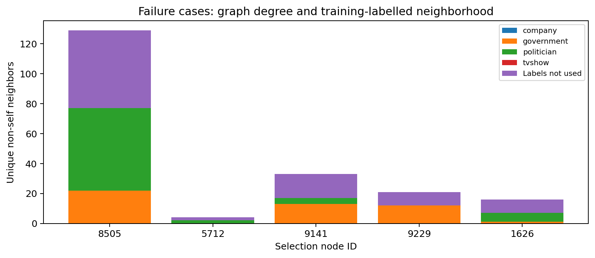

# Facebook Page Classification with a Two-layer GCN

COMP3710 individual Pattern Analysis project, Normal difficulty.

## Current status

Stage 1 is committed as `419b7db` and Stage 2 as `8b916b4` (neither pushed).
Stage 3 is committed as `d108125` and Stage 4 as `55207d4` (not pushed).
Stage 5 is committed as `514067a` (not pushed). Stage 6 confidence and referral
analysis await student review; no held-out test results have been evaluated.
The student explicitly approved the specification-linked, precomputed 128-feature
file after the original PyG download failed. Its different representation and
provenance are documented below. This is not a completed submission. The
held-out test evaluation, final inference driver and
final feasibility review are not implemented yet.

The selected project compares a feature-only MLP with a two-layer graph
convolutional network for transductive Facebook page classification. The planned
investigation asks whether graph context improves classification and confidence
reliability, and how referring uncertain predictions changes error and coverage.
These are planned methods, not findings.

Internal Phase 1 completion target: **20 October 2026**. The student-provided
assessment due date is 30 October 2026; verify the exact official deadline and
the separate compulsory midpoint consultation with teaching staff.

## Repository layout and development workflow

Develop inside `recognition/Facebook_GCN_Jonte/` on the personal fork's
`topic-recognition` branch. `upstream` refers to
<https://github.com/shakes76/PatternAnalysis-2026>; `origin` must refer to the
student's fork. The final PR targets upstream `topic-recognition`.

The assessment requires `modules.py`, `dataset.py`, `train.py`, `predict.py`
and this README. Add each implementation file in its approved stage, rather
than adding empty placeholders. Review and test each milestone before an
explicitly authorised commit. There are no automatic commits.

Datasets, processed caches, model weights, environments and generated experiment
files are excluded by the root `.gitignore`. Curated report figures can later
live in `figures/` and be committed. Never add excluded files with `git add -f`.

## Windows environment setup

Run the following from the repository root in PowerShell. Use the explicit
interpreter path so activation and PowerShell execution-policy changes are not
required. The CUDA build is intended for the verified local NVIDIA GPU.

```powershell
python -m venv .venv
.\.venv\Scripts\python.exe -m pip install -r recognition/Facebook_GCN_Jonte/requirements-torch.txt
.\.venv\Scripts\python.exe -m pip install -r recognition/Facebook_GCN_Jonte/requirements.txt
.\.venv\Scripts\python.exe -m pip check
.\.venv\Scripts\python.exe recognition/Facebook_GCN_Jonte/verify_environment.py --require-cuda
```

The direct dependencies are pinned in `requirements.txt`.
`requirements-lock.txt` records exact installed transitive versions
for this Windows/Python environment. To reproduce that environment, install
`requirements-torch.txt` first, then `requirements-lock.txt` instead of the direct
dependency file. Other operating systems may need different PyTorch wheels.

In VS Code, use **Python: Select Interpreter** and choose
`.venv/Scripts/python.exe`. A default workspace setting is provided; an existing
VS Code interpreter selection may override that default.

## Stage 1 verification

The following automated checks passed on 17 October 2026:

| Check | Actual outcome |
| --- | --- |
| GitHub repository metadata | `LittleEmperor99/PatternAnalysis-2026` is a fork of `shakes76/PatternAnalysis-2026` |
| Branch and tracking | Local `topic-recognition` tracks `origin/topic-recognition` |
| Starting revision | Local, origin and upstream topic branches all at `552b9029a3fbee3e12d0b4e95f38e73d8d1d51a5` |
| Isolated interpreter | `.venv/Scripts/python.exe`, Python 3.13.14, Windows x64 |
| PyTorch / PyG | `2.8.0+cu126` / `2.6.1` |
| Other direct packages | NumPy 2.2.6; scikit-learn 1.7.2; Matplotlib 3.10.7 |
| Dependency consistency | `python -m pip check`: no broken requirements |
| CPU operations | Tensor multiplication, GCNConv forward and finite gradients passed |
| GPU operations | The same checks passed on RTX 2060 SUPER with CUDA runtime 12.6 |
| Interoperability and plotting | scikit-learn metric, NumPy/PyTorch conversion and in-memory PNG rendering passed |
| Git exclusions | Representative datasets, caches, weights and output paths ignored; report figures allowed |

The environment script uses tiny artificial tensors exclusively for software
checks. It does not train a task model, use the Facebook dataset, or produce
experimental evidence. GPU success here is not a measured full-graph memory or
training-time estimate.

GitHub CLI (`gh`) was unavailable, so repository setup used Git and GitHub's
public repository metadata after the student supplied the fork URL. No commit,
push or PR was created; push authentication has not been tested. An initial
inspection of the existing global Python packages encountered malformed package
metadata; the isolated environment passed its own package checks.

The student must still select the VS Code interpreter, review the setup and
code, verify their Git author identity, and confirm the official feasibility
check-off arrangements. The student subsequently approved Stage 1 and explicitly
authorised its commit and Stage 2 development. No push has been made.

## Stage 2: loading, audits and fixed splits

The setting is **transductive node classification**. Every node's descriptive
features and every graph edge remain available, including edges across splits.
This does not test generalisation to unseen graphs or future pages.

The original `FacebookPagePage` download host fails DNS resolution. Appendix A,
item 6 of the supplied PDF links to
<https://github.com/gayanku/facebook_page-page_dataset>; on 17 October 2026 the
student explicitly approved that existing file with its provenance disclosed.
It contains **precomputed 128-dimensional TruncatedSVD features**, not a verified
copy of GraphMining's original embeddings. The source's feature-generation code
uses all node descriptions without labels. Using existing unlabelled features
of all nodes is consistent with the declared transductive setting; this does not
establish an inductive evaluation or equivalence to published PyG benchmarks.

`dataset.py` downloads the immutable source revision
`ec01d02c39da4385052023ed28e36f0794f61dc8`, verifying SHA256
`7a1b8a0687515e9859d1ca649dc276825f5db44568894dfbb6b55ebc1cf6a9c1`
on **every load**. An offline copy must match the same pinned bytes. There is
no automatic source fallback. The file's numeric keys `X`, `y`, `edges_x` and
`edges_y` are adapted to a native `torch_geometric.data.Data` object. The built-in
`FacebookPagePage` loader cannot directly read this schema. No new embedding is
fitted and feature values are preserved. NumPy pickle is disabled; the optional
`page_name` object array is never read. No processed pickle cache is needed.

The loader checks dimensions, finite features, integer targets, edge bounds and
reciprocity, and writes a source/checksum manifest. Supplied edges and self-loops
are preserved. The audit reports **342,004 edge entries**, including 358 self-loop
entries and 179 duplicate ordered entries: reversing a self-loop duplicates it.
There are 171,002 unique unordered pairs including loops and zero isolated nodes.
These counts describe the source; no graph repairs are applied silently.

Final Stage 2 verification also checks PyG 2.6.1's unweighted COO `gcn_norm`
operator with its default self-loop addition and normalization. It replaces
the supplied loops with one self-loop per node: 22,470 loops and 364,116
normalized edge entries. The resulting normalized sparse matrix matches the
matrix obtained from deduplicated input. Thus the documented duplicate loops
do not double self-messages under these specific defaults. Other operators,
explicit edge weights, or disabling self-loop handling require a fresh check.
This is an operator verification, not a GCN implementation or experiment.

Observed features are float32 with shape `(22470, 128)`, all finite, ranging
approximately from -2.037593 to 3.002028. Independent comparison with the raw UCI
release confirms every unique directed edge and every label by node ID. The
actual class mapping is alphabetical and corrects the source README's mapping:

| ID | Class | Nodes |
| --- | --- | ---: |
| 0 | company | 6,495 |
| 1 | government | 6,880 |
| 2 | politician | 5,768 |
| 3 | tvshow | 3,327 |

Split seed **42** is fixed independently of later model training seeds.
Stratified splitting uses scikit-learn 1.7.2 with local `random_state` values;
it does not change global NumPy/PyTorch random states. Actual allocations for
22,470 nodes are:

| Role | Nodes | Purpose |
| --- | ---: | --- |
| Training | 13,482 | Fit task-model weights |
| Validation, total | 4,494 | Union of the three roles below |
| Selection | 2,247 | Early stopping and model selection |
| Calibration | 1,123 | Later confidence calibration |
| Policy | 1,124 | Later rejection-threshold selection |
| Test | 4,494 | Final evaluation after the protocol is frozen |

Per-class split counts (company, government, politician, tvshow) are:

| Partition | Company | Government | Politician | TV show |
| --- | ---: | ---: | ---: | ---: |
| Train | 3,897 | 4,128 | 3,461 | 1,996 |
| Validation, total | 1,299 | 1,376 | 1,153 | 666 |
| Selection | 649 | 688 | 577 | 333 |
| Calibration | 325 | 344 | 288 | 166 |
| Policy | 325 | 344 | 288 | 167 |
| Test | 1,299 | 1,376 | 1,154 | 665 |

The five distinct partitions are exhaustive and disjoint; the combined validation
mask deliberately overlaps its own three subpartitions. Stratification and
descriptive auditing use labels to allocate and count classes. No task model is
trained by the dataset code.

The returned `graph` contains only `x`, `edge_index` and `num_nodes`, with **no
labels**. Labels are separate vectors in boolean-mask order, obtained through
`targets("train")`, `targets("selection")`, etc. `targets("test")` raises unless
`allow_test=True` is explicitly supplied. Combined `val` targets are rejected to
avoid accidentally using calibration/policy labels for checkpoint selection.
This API reduces accidental leakage; it is not a security boundary. Later
training code must still be inspected and tested for correct label use.

Download/load and audit the approved file, then run tests from the repository
root. The dataset download uses a 30-second socket timeout. An existing local
copy of the pinned file can be imported with `--raw-file <path>` instead.

```powershell
.\.venv\Scripts\python.exe recognition/Facebook_GCN_Jonte/dataset.py --audit-output recognition/Facebook_GCN_Jonte/outputs/dataset_audit.json
.\.venv\Scripts\python.exe recognition/Facebook_GCN_Jonte/test_dataset.py -v
```

Latest result on 17 October 2026: **all 28 tests passed: 22 synthetic tests and
6 real-data integration/operator tests, with no skips** in the tested local environment.
Real tests verify exact source bytes and unchanged numeric inputs, graph
integrity, repeatable stratified splits, target separation/mask order and an
independent raw-UCI edge/label comparison. The optional UCI comparison is skipped
on a clean machine unless its reference archive is downloaded; the other four
real tests run after the approved file is downloaded. Synthetic
coverage includes class balance, disjoint/exhaustive masks, seed repeatability,
unchanged global random states, label separation, explicit test-target access,
malformed input rejection, checksum/corruption detection, failed-download cleanup
and offline loading/reloading with artificial fixtures. All checks concern the
data pipeline; they are not task-model performance results.

A separate fresh-root download from the pinned URL also succeeded and matched
the same SHA256. The default-root audit command succeeded and wrote the actual
dataset statistics and mask hashes to the ignored output JSON.

To reproduce the independent comparison, download the pinned raw reference:

```powershell
New-Item -ItemType Directory -Force recognition/Facebook_GCN_Jonte/data/reference | Out-Null
Invoke-WebRequest -Uri 'https://archive.ics.uci.edu/static/public/527/facebook+large+page+page+network.zip' -OutFile recognition/Facebook_GCN_Jonte/data/reference/uci-facebook.zip
.\.venv\Scripts\python.exe recognition/Facebook_GCN_Jonte/test_dataset.py -v
```

The comparison test verifies the reference archive's checksum before using it.
Generated JSON, downloaded files and Python caches remain excluded from Git;
audit tables and provenance are included here as documentation. See
[DATA_PROVENANCE.md](DATA_PROVENANCE.md) for exact source details and the original
download investigation. No additional dependency was needed in Stage 2.

## Stage 3: feature-only MLP baseline

`modules.py` defines an MLP with two linear layers: **128 -> 64 -> 4**, with ReLU
and dropout (0.5) between them. It has **8,516 trainable parameters**. Each node
is classified independently from its supplied features; no graph edges or labels
enter the model's forward method. The output is four raw logits, suitable for
PyTorch cross-entropy without a preceding softmax.

`train.py` performs full-batch training on the 13,482 training nodes. It requests
only `train` and `selection` targets. The 2,247 selection nodes control early
stopping; the combined validation mask is not used for model selection.
Calibration, policy and test targets are unused. Training uses Adam with learning
rate 0.01 and weight decay 0.0005. Uniform cross-entropy is the initial baseline;
macro-F1 gives equal weight to classes when selecting a checkpoint.

The predeclared epoch limit is 300 with patience 30 and minimum macro-F1
improvement 0.0001. Validation runs after each optimizer step with dropout off.
The best checkpoint is restored before reporting final training/selection
metrics. A seeded setup enables deterministic PyTorch operations, disables TF32
and configures cuBLAS deterministic workspace behavior. Split seed 42 remains
independent of training seed 42. Reproducibility is scoped to the recorded
software/hardware environment; cross-platform bitwise equivalence is not claimed.

Run the smoke test and baseline from the repository root:

```powershell
.\.venv\Scripts\python.exe recognition/Facebook_GCN_Jonte/train.py --max-epochs 3 --patience 3 --output-dir recognition/Facebook_GCN_Jonte/outputs/mlp_smoke_seed42
.\.venv\Scripts\python.exe recognition/Facebook_GCN_Jonte/train.py --output-dir recognition/Facebook_GCN_Jonte/outputs/mlp_seed42
.\.venv\Scripts\python.exe recognition/Facebook_GCN_Jonte/test_train.py -v
```

Use a new output directory when repeating a run; existing nonempty directories
are rejected to preserve experimental records. Each run writes `best.pt`,
`history.json`, `summary.json` and `learning_curves.png` under the ignored output
directory. Checkpoints contain model weights, configuration, source/data hashes,
split hashes, epoch and selection metrics. They contain no dataset and are not
committed. Metadata records that the training code was uncommitted during the
run, together with hashes of the exact code used and its parent Git revision.
Historical run metadata records parent `d117a07`; a later local
documentation-only history rewrite maps it to `8b916b4`. Executable
code hashes and the original experiment records remain unchanged.

### Actual results on 17 October 2026

The baseline and a reproducibility rerun have been completed; these are **selection-set
results**, not held-out test results or multi-seed estimates.

| Measurement | Smoke run | Baseline run |
| --- | ---: | ---: |
| Training seed / split seed | 42 / 42 | 42 / 42 |
| Epochs completed | 3 | 178 |
| Restored checkpoint epoch | 3 | 148 |
| Restored training cross-entropy, dropout off | 1.266068 | 0.473551 |
| Restored training accuracy | 57.47% | 82.04% |
| Restored selection cross-entropy | 1.271151 | 0.571925 |
| Restored selection accuracy | 56.25% | 79.08% |
| Restored selection macro-F1 | 0.450232 | 0.774272 |
| Measured training-loop seconds | 0.6301 | 1.7253 |

The baseline stopped after 30 consecutive epochs without a qualifying macro-F1
improvement. Its final optimization loss was 0.506910; that loss uses active
dropout and belongs to the last training step, whereas the table's training loss
is recomputed at the restored checkpoint with dropout disabled.

| Baseline resource measurement | Actual value |
| --- | ---: |
| Device | NVIDIA GeForce RTX 2060 SUPER, CUDA |
| Trainable parameters | 8,516 |
| Peak PyTorch CUDA allocated memory | 82.81 MiB |
| Peak PyTorch CUDA reserved memory | 88.00 MiB |
| Maximum sampled process resident memory | 1,096.55 MiB |

The synchronized timer includes training steps, selection validation and
checkpoint writes. It excludes data loading, model/tensor setup, final restored
evaluation and plotting; **1.7253 seconds is not total command runtime**. CUDA
memory peaks cover tensor/model setup through restored-checkpoint evaluation;
they measure this process's PyTorch allocator, not total board memory. Process
resident memory includes Python and loaded libraries and is sampled at setup
and after epochs, so it is not an exact OS-level peak. `psutil` was already
installed transitively and is now listed as a pinned direct dependency.


Loss falls while selection performance levels off. The restored training versus
selection scores show a generalisation gap. These observations justify retaining
regularisation and early stopping, but do not establish confidence calibration
or performance on the test nodes. The configuration was not retuned after this
run; the future GCN will use the same splits for comparison.

### Stage 3 verification

All **six MLP/training tests passed**, using the real approved data for their
short fits. They check the architecture and independent node processing, safe
checkpoint reload and matching selection metrics, real early stopping and
best-weight restoration, output preservation and split-seed consistency.
An isolation test replaces calibration/policy/test targets with invalid values
and denies access to them: training requests only train and selection labels,
and produces identical selected weights and metrics.

A fresh full rerun reproduced all 178 history rows, selected weights and curve
PNG bytes exactly; fresh-process checkpoint restoration matched selection metrics.
Its measured training-loop time was 2.2121 seconds versus 1.7253 originally;
wall-clock timings and process memory are not expected to be bitwise reproducible.

The three-epoch real-data smoke run completed before the baseline run. An
initial smoke attempt exposed a CUDA profiling initialization issue; selecting
the CUDA device before resetting memory statistics fixed it. The genuine run's
checkpoint was also loaded in a fresh process: its selection metrics matched,
and its recorded executable-code hashes matched the files on disk. All 28
Stage 2 tests passed again before its commit. No GCN model, calibration,
rejection policy, AUROC analysis or test-set performance evaluation is included
in Stage 3.

## Stage 4: two-layer GCN

`GCN` in `modules.py` uses **GCNConv(128, 64) -> ReLU -> dropout(0.5) ->
GCNConv(64, 4)** and returns raw logits. It has 8,516 trainable parameters,
the same count as the MLP. Each layer aggregates degree-normalized neighbor
features, including one self-message. Two layers provide two-hop graph context.
The MLP remains a feature-only comparison; graph structure is the key additional
input, although PyG and Linear layers also use different default initialization.

The shared trainer accepts `--model mlp` (default) or `--model gcn`. Adam,
learning rate 0.01, weight decay 0.0005, maximum 300 epochs, patience 30,
minimum selection macro-F1 improvement 0.0001 and both seeds 42 are unchanged.
GCN forwards use the full fixed graph, then index **only training logits** for
cross-entropy. Selection labels are used only for validation/checkpoint choice.
Calibration, policy and test targets are never requested. All graph features and
edges, including those of reserved nodes, are available under the documented
transductive setting; this is not an inductive unseen-graph experiment.

Both convolutions use unweighted COO edges, `normalize=True`,
`add_self_loops=True` and `cached=True`. In this setting PyG replaces supplied
self-loops, including their duplicates, with one per node: normalization has
364,116 edge entries and 22,470 self-loops. A real-graph test confirms matching
outputs against deduplicated, loop-free input normalized by a fresh model.
No source edges are modified. The cache is valid **only for the same fixed
graph and device**; instantiate a fresh model for a different graph. Cache
tensors are absent from checkpoints and rebuild automatically after loading.

```powershell
.\.venv\Scripts\python.exe recognition/Facebook_GCN_Jonte/train.py --model gcn --max-epochs 3 --patience 3 --output-dir recognition/Facebook_GCN_Jonte/outputs/gcn_smoke_seed42
.\.venv\Scripts\python.exe recognition/Facebook_GCN_Jonte/train.py --model gcn --output-dir recognition/Facebook_GCN_Jonte/outputs/gcn_seed42
.\.venv\Scripts\python.exe -m unittest discover -s recognition/Facebook_GCN_Jonte -p "test_*.py" -v
```

Use fresh output directories for repeats. Run artifacts remain ignored, with
source/data/split hashes retained in checkpoints and summaries. No new packages
were required. Deterministic CUDA operations worked with the installed PyTorch
2.8.0+cu126 / PyG 2.6.1; no nondeterministic fallback was enabled.

### Measured seed-42 selection comparison

| Measurement | MLP baseline | GCN |
| --- | ---: | ---: |
| Epochs completed | 178 | 200 |
| Restored best epoch | 148 | 170 |
| Restored training cross-entropy | 0.473551 | 0.235384 |
| Restored selection cross-entropy | 0.571925 | 0.290938 |
| Selection accuracy | 79.08% | 91.59% |
| Selection macro-F1 | 0.774272 | 0.910558 |
| Trainable parameters | 8,516 | 8,516 |
| Measured training-loop seconds | 1.7253 | 22.7897 |
| Peak CUDA allocated memory, MiB | 82.81 | 1,893.84 |
| Peak CUDA reserved memory, MiB | 88.00 | 2,240.00 |
| Maximum sampled process RSS, MiB | 1,096.55 | 1,354.15 |

Both runs used the RTX 2060 SUPER. Timing/memory scopes are as defined in Stage
3; these are single-run measurements, not controlled benchmark estimates.
CPU validation tests overlapped part of the first GCN run. The three-epoch GCN
smoke run completed successfully (selection accuracy 63.11%, macro-F1 0.511298).
The full GCN stopped at epoch 200 and restored epoch 170; final optimization
loss with dropout was 0.240887, while restored training accuracy was 92.92%.

GCN improved selection accuracy by **12.51 percentage points** and macro-F1 by
**0.136286** with the same parameter count. This supports using graph context
for this split, at greater memory and computation cost. It does not establish
held-out test performance or variability across training seeds. No settings
were retuned using these results.


### Verification and limitations

All **38 tests passed**: the existing 28 data tests, six MLP tests and four new
real-data GCN tests. New checks cover architecture/graph dependence, actual
normalized-loop behavior, early stopping, cache reconstruction after checkpoint
reload and reserved-label isolation. Poisoning calibration/policy/test targets
leaves selected GCN weights and metrics unchanged; access is restricted to
training and selection targets. A full MLP run through the shared trainer
reproduced the original history, weights and curve PNG exactly. A second full
GCN run reproduced all 200 history rows, selected weights and curve PNG bytes;
its measured loop time was 21.9666 seconds. Fresh-process CUDA reload rebuilt
both normalization caches and exactly matched selection metrics. Recorded
source hashes match the executable files, and all split hashes match the MLP.

PyG's inspector emits a Python 3.13 typing deprecation warning during tests;
execution succeeds, and no dependency change was needed. Future Python 3.15
compatibility is outside the pinned environment. Final test metrics, advanced
visualizations and confidence/rejection analysis remain for later stages.

## Stage 5: selection evaluation and visualisations (18 October 2026)

`evaluate.py` loads the original frozen checkpoints (MLP epoch 148, GCN epoch
170), verifies their data/split hashes and recomputes selection metrics. No
training, model changes or hyperparameter search occurs. Only the 2,247 selection
labels are requested; calibration, policy and held-out test targets remain unused.
These are development results on a partition already used for early stopping,
so they are not an unbiased final performance estimate.

Predictions are argmax of raw logits. Softmax probabilities supply one score per
class for one-vs-rest AUROC. Precision/recall/F1 use explicit class ID order and
zero precision when a class has no predictions; macro values weight the four
classes equally. Macro AUROC is the unweighted mean of four class-versus-rest
AUROCs. Undefined AUROC (a missing true class) fails explicitly. AUROC measures
ranking discrimination, not probability calibration.

```powershell
.\.venv\Scripts\python.exe recognition/Facebook_GCN_Jonte/evaluate.py
```

The default fresh directory is `outputs/evaluation_selection_seed42`; use
`--output-dir` for repeats. This requires the genuine checkpoints created by the
documented training commands. Node probabilities, embeddings, t-SNE coordinates
and individual latency samples stay in ignored `outputs/` files. Curated
aggregate JSON/CSV tables are available locally under `reports/` (local, ignored); report figures are
under `figures/` as PNG and vector SVG. No new dependency is required.

### Selection results

| Model | Accuracy | Macro precision | Macro recall | Macro-F1 | Macro OvR AUROC |
| --- | ---: | ---: | ---: | ---: | ---: |
| MLP | 0.790832 | 0.779994 | 0.770415 | 0.774272 | 0.942277 |
| GCN | 0.915888 | 0.913772 | 0.907731 | 0.910558 | 0.983507 |

| Model | Class | Support | Precision | Recall | F1 | OvR AUROC |
| --- | --- | ---: | ---: | ---: | ---: | ---: |
| MLP | company | 649 | 0.827907 | 0.822804 | 0.825348 | 0.948945 |
| MLP | government | 688 | 0.794944 | 0.822674 | 0.808571 | 0.945113 |
| MLP | politician | 577 | 0.783333 | 0.814558 | 0.798641 | 0.953028 |
| MLP | tvshow | 333 | 0.713793 | 0.621622 | 0.664526 | 0.922021 |
| GCN | company | 649 | 0.911179 | 0.916795 | 0.913978 | 0.979593 |
| GCN | government | 688 | 0.914530 | 0.933140 | 0.923741 | 0.981054 |
| GCN | politician | 577 | 0.934142 | 0.934142 | 0.934142 | 0.989909 |
| GCN | tvshow | 333 | 0.895238 | 0.846847 | 0.870370 | 0.983473 |

The GCN improves all four class F1 scores. TV shows remain the weakest class:
recall rises from 62.16% to 84.68%, with 31 GCN TV-show nodes still classified
as company pages. Government/politician confusions fall from 154 reciprocal
errors in the MLP to 46 in the GCN. These aggregate observations are limited to
the selection nodes; individual failure-case investigation belongs to Stage 6.

Confusion matrices show **true classes on rows, predictions on columns**.
Annotations include counts and percentages within each true class, with a shared
0?1 colour scale, so minority-class recall remains visible.


### Hidden embedding visualisation

The GCN embedding is the 64-dimensional `ReLU(conv1)` output with dropout off.
It is computed with the full graph, then restricted to all 2,247 selection nodes.
One t-SNE fit uses seed 42, perplexity 30, PCA initialization, automatic learning
rate, Barnes?Hut approximation and 1,000 maximum iterations (`n_jobs=1`). Labels
are supplied only for plot colours, never to t-SNE. Settings are recorded in JSON;
no projection settings were chosen after viewing alternative plots.


Broad class groupings and a mixed central region are visible. This is qualitative
evidence only: two-dimensional distances, apparent cluster sizes and empty space
do not directly represent original feature distances or establish accuracy.

### Inference resources

Both models run `eval()` under `torch.inference_mode()` on **all 22,470 nodes**.
Features and, for GCN, edges are already resident on the same RTX 2060 SUPER.
The first forward is timed separately; it includes GCN normalization-cache
creation and first-use kernel overheads, but excludes checkpoint loading and
input transfer. Then 20 warm-up calls precede 100 timed calls. CUDA synchronizes
before and after every timed call; values are wall-clock model latency including
Python/launch overhead. Metrics, softmax, transfers and plotting are excluded.
GCN steady-state calls retain its fixed-graph normalization cache. These are
full-graph latencies, not independent single-page response times.

| Measurement | MLP | GCN |
| --- | ---: | ---: |
| Parameters | 8,516 | 8,516 |
| First forward, ms | 67.775 | 385.775 |
| Steady-state mean, ms | 0.387 | 52.888 |
| Steady-state median, ms | 0.348 | 52.835 |
| Steady-state 95th percentile, ms | 0.627 | 60.560 |
| Peak inference CUDA allocated, MiB | 54.00 | 1860.69 |
| Peak inference CUDA reserved, MiB | 66.00 | 2240.00 |

Each model starts after garbage collection and CUDA cache clearing. CUDA peaks
cover model/input setup, first forward, warm-up, timed calls and selection metric
computation, before embedding extraction. They include the live input/model and
GCN graph/cache tensors; they are neither incremental kernel workspace nor total
board usage. Inference peaks have a different scope from the Stage 3/4 training
peaks and should not be compared as identical workloads. Strict deterministic
operations remain enabled. Latencies vary with system load, device clocks and
software; these measurements describe this environment, not a general hardware
benchmark. Smaller parameter count alone does not imply inexpensive graph
message passing.

### Stage 5 validation

All **45 tests passed**, including seven new evaluation tests. Hand-checkable
synthetic metric fixtures independently verify precision/recall/F1, confusion
counts and AUROC by positive-versus-negative pair rankings; they are not project
training data. Real-checkpoint tests cover provenance/split mismatch rejection,
end-to-end JSON/CSV/PNG/SVG exports, hidden dimensions and selected node IDs.
Replacing every non-selection target with an invalid value leaves GCN metrics,
probabilities and embeddings unchanged; the pipeline denies all non-selection
target requests. Both models' restored selection metrics match their original
checkpoints. The first test run exposed an incorrect hand-calculated expected
precision/F1 in the synthetic fixture; those expectations were corrected and
the full suite passed. A second complete CUDA evaluation reproduced metrics,
probabilities, hidden embeddings, t-SNE coordinates and PNG figures exactly.
Median full-graph times in that repeat were 0.322 ms (MLP) and 58.735 ms (GCN),
illustrating timing variability; the tables retain the first measured run.
The existing PyG typing deprecation warning remains.

## Stage 6: confidence calibration and referral (18 October 2026)

`confidence.py` keeps both trained checkpoints unchanged. It follows separate
roles: **calibration** (1,123 nodes) fits one temperature per model; **policy**
(1,124 nodes) chooses a referral threshold; **selection** (2,247 nodes) provides
development reliability comparisons and illustrative errors. Training labels
are used only for neighborhood diagnostics. No held-out test targets or metrics
are accessed. Selection results remain development evidence because those nodes
previously selected checkpoints.

### Predeclared methodology

Confidence is maximum softmax probability. Temperature scaling computes
`softmax(logits / T)` with a positive scalar T, preserving predicted classes.
Calibration NLL alone fits T in [0.05, 20], by 60 deterministic bisection steps
on the monotone derivative of convex NLL in inverse temperature. T=1 is retained
if numerical fitting cannot improve calibration NLL; no selection or policy
labels fit this parameter. This implements the single-temperature approach of
[Guo et al. (2017)](https://proceedings.mlr.press/v70/guo17a.html).

Top-label ECE uses 15 fixed equal-width bins on [0,1], left-closed/right-open
except the last bin includes 1. Empty bins contribute zero. ECE is the
count-weighted absolute gap between bin accuracy and mean confidence. NLL uses
stable log-softmax. Brier score is the mean **sum over all four classes** of
squared probability errors (range 0?2), without division by class count.
Correct/incorrect confidence distributions use all selection nodes, with each
group separately normalized to density; counts and exact bin statistics are
included in the aggregate JSON.

The policy accepts iff calibrated confidence **>= threshold**. Search all unique
policy confidences and choose the attainable threshold with highest coverage
whose observed accepted-case error is <=5%, requiring **at least 100 accepted
nodes** (about 8.9% of the policy partition). Entire confidence ties are included.
If no threshold is feasible, refer all and report accepted error as undefined.
This simple empirical procedure does not implement a formal risk guarantee.
The objective, minimum count and bin/temperature settings were set before the
runs and were not changed after inspecting outcomes.

```powershell
.\.venv\Scripts\python.exe recognition/Facebook_GCN_Jonte/confidence.py
.\.venv\Scripts\python.exe recognition/Facebook_GCN_Jonte/test_confidence.py -v
```

Use a fresh `--output-dir` for repeats. The default is `outputs/confidence_seed42`.
`reports/referral_policy.json` records the exact fitted temperatures, thresholds,
checkpoint/data/split hashes and decision rule for subsequent frozen evaluation.
Use its full precision rather than copying rounded README values. Calibration
and threshold calculations use CPU float64 on the frozen model logits; subsequent
inference must use the same probability/acceptance functions. Raw development
logits and pointwise risk-curve outputs remain ignored. No new packages or model
training were needed.

### Measured calibration results

| Model | Fitted T | Calibration NLL before | Calibration NLL after |
| --- | ---: | ---: | ---: |
| MLP | 0.944065 | 0.543933 | 0.543309 |
| GCN | 0.783617 | 0.233817 | 0.224742 |

Selection results (before -> after temperature scaling):

| Model | ECE | NLL | Brier | Mean confidence: correct | Mean confidence: incorrect |
| --- | ---: | ---: | ---: | ---: | ---: |
| MLP | 0.041857 -> 0.039367 | 0.571925 -> 0.572871 | 0.304633 -> 0.303915 | 0.817426 -> 0.826414 | 0.578736 -> 0.590026 |
| GCN | 0.039970 -> 0.028464 | 0.290938 -> 0.295654 | 0.139148 -> 0.135150 | 0.907714 -> 0.935485 | 0.676321 -> 0.721929 |

Both fitted temperatures are below 1, increasing confidence. Selection ECE and
Brier improve, but **selection NLL worsens for both models**, despite improvement
on the calibration fitting partition. On policy nodes, MLP ECE also worsens
(0.043922 -> 0.046344), while GCN ECE improves (0.034850 -> 0.025303).
Calibration therefore has mixed out-of-fit effects; it is not uniformly better.
One small calibration partition and a single scalar cannot guarantee reliability
for every class or node. ECE depends on binning and may hide confident rare
errors; low-count bins have substantial sampling variability.

GCN makes fewer mistakes (189 versus 470 selection errors), and has lower ECE,
NLL and Brier overall, but its remaining mistakes are **more confident on
average** than MLP mistakes. Accuracy, probability calibration and detecting
individual errors are distinct engineering properties.


### Selected operating points

| Model | Threshold | Policy accepted / total | Errors among accepted | Coverage | Referral rate | Accepted-case error |
| --- | ---: | ---: | ---: | ---: | ---: | ---: |
| MLP | 0.876537148 | 525 / 1124 | 26 | 46.71% | 53.29% | 4.95% |
| GCN | 0.634198681 | 1021 / 1124 | 51 | 90.84% | 9.16% | 5.00% |

Both thresholds satisfy the predeclared **observed policy** criterion. Applying
them unchanged to selection nodes gives:

| Model | Accepted / total | Accepted errors | Coverage | Referral rate | Accepted-case error |
| --- | ---: | ---: | ---: | ---: | ---: |
| MLP | 1039 / 2247 | 53 | 46.24% | 53.76% | 5.10% |
| GCN | 2081 / 2247 | 117 | 92.61% | 7.39% | 5.62% |

The selection error exceeds 5% for both fixed policies. This directly shows why
a threshold chosen to meet an observed error target is **not a future safety
guarantee**. Threshold search is adaptive, samples are finite, and nodes share
graph context. No safety certification, distribution-shift protection or human
review accuracy is established here. Lower coverage increases reviewer workload
and can reduce accepted-case error; confident errors still escape referral.
GCN offers much greater automation at this objective, while MLP refers a larger
fraction of its errors (88.72% versus GCN's 38.10% on selection nodes).
The methods and policy values remain fixed despite these results.


### Five genuine development failure examples

Cases are selected deterministically to illustrate high/low-confidence GCN
errors and disagreements, rather than as a representative random sample.
Confidence below is temperature-scaled; full raw/scaled values and exact node IDs
are in `reports/failure_cases.csv` and `reports/confidence_summary.json`.

| Node | True class | Degree | MLP prediction / confidence / referred | GCN prediction / confidence / referred |
| --- | --- | ---: | --- | --- |
| 8505 | government | 129 | politician / 0.946076 / no | politician / 0.999967 / no |
| 5712 | politician | 4 | government / 0.314796 / yes | government / 0.284373 / yes |
| 9141 | politician | 33 | politician / 0.998607 / no | government / 0.997739 / no |
| 9229 | government | 21 | politician / 0.999479 / no | government / 0.998656 / no |
| 1626 | company | 16 | politician / 0.559255 / yes | politician / 0.999855 / no |

Degree counts unique non-self neighbors, removing raw duplicate edges/loops for
this diagnostic only. Neighbor class counts use **training labels only**;
other neighbors remain unlabelled in this analysis. Labels are not inputs to GCN
message passing. Observations and possible explanations are separated below:

- **8505:** 55 politician and 22 government training-labelled neighbors among
  degree 129. Both models are wrong; GCN is extremely confident and not referred.
  Neighbor mismatch is consistent with graph-context influence, not proof of it.
- **5712:** degree 4, with two known politician neighbors, yet both predict
  government with low confidence and are referred. Sparse context is a possible
  limitation; the known neighbor labels do not explain the wrong class by a
  simple majority argument.
- **9141:** 13 government and four politician training-labelled neighbors among
  degree 33. MLP correctly predicts politician while GCN confidently predicts
  government and escapes referral. Graph aggregation may contribute to the flip.
- **9229:** all 12 training-labelled neighbors are government (degree 21).
  GCN corrects the MLP's highly confident politician error, consistent with
  useful graph context; neither prediction is referred.
- **1626:** six politician and one government training-labelled neighbors
  (degree 16), with no known company neighbor. Both are wrong, but MLP is
  referred while the highly confident GCN is accepted. This illustrates a
  potentially harmful confidence increase from aggregation.

These are hypotheses about model behavior, not causal conclusions: no graph
ablation or page-content review was performed. Semantic government/politician
ambiguity cannot be verified from the supplied SVD features alone. Two-hop
context and neighbors without used labels may also matter.



### Stage 6 verification and limits

All **54 tests passed**, including nine new tests for analytic ECE/NLL/Brier,
known temperature optimum and boundary behavior, stable extreme logits,
argmax preservation, whole confidence ties, no-feasible-policy behavior,
maximum-coverage threshold search against brute force on the real data, actual
case predictions/degrees, and full pipeline exports. Instrumented pipeline tests
verify that fitting receives calibration targets and threshold search receives
policy targets. Held-out labels are poisoned and their access is forbidden.
Checkpoint architectures and hashes remain unchanged. The existing PyG typing
deprecation warning persists; it did not prevent execution. A second genuine
CUDA run reproduced temperatures, thresholds, all confidence metrics, selected
cases, development logits and PNG figures exactly. Report exports match the
original outputs; both checkpoint hashes match the committed Stage 5 report.
These parameters/methods are fixed for subsequent evaluation and await student
review before the Stage 6 commit. Final test evaluation has not begun.

## Sources consulted for setup

- Supplied `COMP3710_Report_2026_draft_v2.3.pdf`, especially Sections 2.1 and 3–6.
  Its cover says Version 2.2 and DRAFT; confirm the operative version with staff.
- PyTorch installation: <https://pytorch.org/get-started/locally/>.
- PyG installation: <https://pytorch-geometric.readthedocs.io/en/latest/install/installation.html>.
- PyG dataset: <https://pytorch-geometric.readthedocs.io/en/2.6.1/generated/torch_geometric.datasets.FacebookPagePage.html>.

- PyG GCNConv implementation: <https://pytorch-geometric.readthedocs.io/en/2.6.1/_modules/torch_geometric/nn/conv/gcn_conv.html>.

- sklearn metrics: <https://scikit-learn.org/1.7/modules/generated/sklearn.metrics.roc_auc_score.html>.
- sklearn t-SNE: <https://scikit-learn.org/1.7/modules/generated/sklearn.manifold.TSNE.html>.
- PyTorch CUDA timing: <https://docs.pytorch.org/docs/stable/notes/cuda.html>.

- Selective classification: Geifman and El-Yaniv (2017), <https://proceedings.neurips.cc/paper/2017/hash/4a8423d5e91fda00bb7e46540e2b0cf1-Abstract.html>. The present empirical threshold search does not claim their formal risk guarantee.

Repository restriction: generated CSV/JSON reports are kept locally in ignored
`reports/` and `outputs/`. Previously tracked Stage 5 aggregate files were removed
from the current Git tree in Stage 6 without rewriting existing history.
