# Facebook Page Classification: Does Graph Context Justify Its Cost?

**COMP3710 Pattern Analysis — Normal-difficulty Multi-layer GNN**

Author account: [LittleEmperor99](https://github.com/LittleEmperor99).

Status: experiments completed 18 October 2026; final verification repeated
28 October 2026. **Development and held-out
test results are distinguished below. Tutor check-off and external submissions
remain pending.**

This prototype classifies official Facebook pages as company, government,
politician or TV show using a feature-only MLP and a two-layer GCN. Its intended
user is an analyst deciding which labels to automate and which to review. The
engineering question is whether graph context improves classification and
confidence reliability enough to justify its computational cost. GCN improves
held-out accuracy from 78.95% to 92.48%. Frozen referral rules achieve observed
test accepted-case error below 5%, but still accept nearly certain wrong labels.
The same rules exceeded 5% on selection nodes; autonomous safety is not established.

## One-page feasibility review

*Prepared 18 October 2026 from actual prototype evidence. This consolidates
feasibility; it does not claim an earlier consultation or retrospective approval.*

**User need and scope.** A social-network analyst needs four-class page labels
with manageable review effort. The prototype uses a fixed public graph in a
transductive setting. It compares a small MLP with a Normal-difficulty two-layer
GCN; additional architecture search is outside scope.

**Acceptance criteria.** These review gates are not retrospective claims of
preregistered performance targets: (1) deterministic, disjoint label roles and
no test-label access during development; (2) finite, reproducible predictions
with GCN improving selection macro-F1 over MLP on identical nodes; (3) inference
below 3 GiB allocated CUDA memory and 100 ms median per full graph on the
available GPU; (4) at least 100 automated policy cases at observed error <=5%,
with coverage and external development checks reported; (5) five genuine
failures showing where referral succeeds or fails. Observed error is not a
future safety guarantee.

**Model and course foundations.** The specification-linked artifact contains
22,470 nodes and 128 precomputed SVD features. MLP and GCN use 128 -> 64 -> 4,
ReLU, dropout and cross-entropy. GCN adds symmetric degree-normalized aggregation,
linking graph/spectral filtering with representation learning [1]. Temperature
scaling [2] and a separately selected threshold address confidence reliability.

**Preliminary evidence.** Checksum, class and edge audits passed; three-epoch
real-data smoke runs succeeded. The genuine baseline reached selection macro-F1
0.774272; GCN reached 0.910558. GCN median full-graph inference was 52.835 ms,
with 1,860.69 MiB peak allocated CUDA memory. Both fit on the local RTX 2060
SUPER 8 GB; Rangpur is unnecessary for this prototype.

**Risks, budget and fallback.** Broken original hosting was resolved with the
file actually linked by the specification, with explicit provenance. Remaining
risks are single-split uncertainty, imperfect calibration and confident errors.
Keep two small frozen models and one training seed; next apply the approved
policy unchanged to held-out nodes. MLP is the low-cost fallback if graph/GPU
resources are unavailable. Report any failure of the operating target instead
of tuning on test labels.

**Consultation status:** pending. The student reports the updated course-profile
check-off period as **19–30 October 2026** and plans an upcoming practical.
This review does not complete the tutor-recorded hurdle. The review is isolated to one page in the PDF export; completion of this written
review does not replace the pending consultation.

## Dataset provenance and label separation

The [UCI Facebook Large Page-Page Network][uci] contains official pages linked
by mutual likes, with page-description features [4]. Its raw release has 4,714
word features. The original PyG download host failed DNS resolution. Appendix A
item 6 of the supplied PDF instead links to the [gayanku repository][artifact];
the student explicitly approved its existing 128-feature file on 17 October.
It supplies **precomputed TruncatedSVD features**, not a verified copy of the
original GraphMining/PyG feature matrix. No replacement representation was fitted
locally. The source's SVD used all descriptions without class labels, consistent
with this transductive setting. Staff approval of equivalence is not claimed.

- Source revision: `ec01d02c39da4385052023ed28e36f0794f61dc8`.
- NPZ SHA-256: `7a1b8a0687515e9859d1ca649dc276825f5db44568894dfbb6b55ebc1cf6a9c1`.
- Features: **22,470 x 128**, finite float32; four classes.
- Graph: **342,004 directed edge entries**, reciprocal/undirected; no isolated
  nodes; 358 self-loop entries, including 179 duplicate ordered entries.
- All labels by node ID and unique directed edges match the independent UCI
  release. Actual class IDs below correct the source README's inconsistent order.
- The loader verifies the pinned checksum, reads numeric arrays with
  `allow_pickle=False`, and never loads the object-valued page-name field.
  See [DATA_PROVENANCE.md](DATA_PROVENANCE.md) for the source investigation.

| Class ID | Class | All nodes | Selection nodes |
| --- | --- | ---: | ---: |
| 0 | company | 6,495 | 649 |
| 1 | government | 6,880 | 688 |
| 2 | politician | 5,768 | 577 |
| 3 | tvshow | 3,327 | 333 |

This is **transductive node classification**, not generalization to unseen
graphs: all features and edges are visible, including cross-split edges. Labels
never enter the graph passed to a model or its forward method. Stratification
uses local seed 42, preserving class proportions. The five roles are exhaustive
and pairwise disjoint:

| Role | Nodes | Permitted use |
| --- | ---: | --- |
| Training | 13,482 (60%) | Cross-entropy and gradient updates |
| Selection | 2,247 (10%) | Early stopping; development comparisons/examples |
| Calibration | 1,123 (~5%) | Fit one temperature per model using NLL |
| Policy | 1,124 (~5%) | Select the confidence threshold |
| Test | 4,494 (20%) | Final held-out evaluation only; no tuning |

The middle three roles form 20% validation, but its combined mask never selects
checkpoints. Stratification/audits use labels for bookkeeping, not learning.
The API guards test-target access; tests poison reserved labels to detect misuse.
Separate calibration and policy roles prevent fitting both decisions to the
same labels. Shared graph context still precludes independent-sample guarantees.

## Working principles and frozen training

MLP applies Linear(128,64), ReLU, dropout(0.5), Linear(64,4). GCN [1] replaces
the linear layers with PyG `GCNConv`. With normalized propagation
`P = D^(-1/2) (A + I) D^(-1/2)`, it computes
`H = ReLU(P X W0 + b0)` and `Z = P Dropout(H) W1 + b1`.
Two layers aggregate two-hop feature context. Both have **8,516 parameters** and
return raw logits; cross-entropy supplies log-softmax. Components use only
PyTorch/PyG; NumPy/sklearn support data handling, metrics and visualisation.
This implements standard models, not a new architecture or a previous student
project. PyG and Linear use different default initializers, so equal settings
and parameter counts do not imply identical optimization trajectories.

For unweighted COO input, PyG replaces supplied self-loops with exactly one per
node. Normalization has **364,116 entries and 22,470 self-loops**. Real-data
tests match outputs against deduplicated, loop-free input normalized by a fresh
model. `cached=True` is valid only on this fixed graph/device; fresh instances
rebuild caches after checkpoint loading or graph changes.

Both models use Adam, learning rate **0.01**, weight decay **0.0005**, dropout
**0.5**, maximum **300 epochs**, patience **30** and minimum selection macro-F1
improvement **0.0001**. Training/split seeds are separately configured as 42.
MLP trains on training rows; GCN uses full-graph forwards then masks logits to
training nodes before loss. Selection uses dropout off and no gradients. The
best checkpoint is restored; calibration, policy and test labels never select
neural weights. Models and these settings are now frozen.

## Genuine development experiments

One predeclared seed was used, followed by reproducibility runs; results are
not multi-seed averages. MLP stopped at epoch 178 and restored **148**; GCN
stopped at 200 and restored **170**. No settings were retuned after comparison.

| Model | Restored training CE | Selection CE | Accuracy | Macro precision | Macro recall | Macro-F1 | Macro OvR AUROC |
| --- | ---: | ---: | ---: | ---: | ---: | ---: | ---: |
| MLP | 0.473551 | 0.571925 | 79.08% | 0.779994 | 0.770415 | 0.774272 | 0.942277 |
| GCN | 0.235384 | 0.290938 | 91.59% | 0.913772 | 0.907731 | 0.910558 | 0.983507 |

| Model | Class | Precision | Recall | F1 | OvR AUROC |
| --- | --- | ---: | ---: | ---: | ---: |
| MLP | company | 0.827907 | 0.822804 | 0.825348 | 0.948945 |
| MLP | government | 0.794944 | 0.822674 | 0.808571 | 0.945113 |
| MLP | politician | 0.783333 | 0.814558 | 0.798641 | 0.953028 |
| MLP | tvshow | 0.713793 | 0.621622 | 0.664526 | 0.922021 |
| GCN | company | 0.911179 | 0.916795 | 0.913978 | 0.979593 |
| GCN | government | 0.914530 | 0.933140 | 0.923741 | 0.981054 |
| GCN | politician | 0.934142 | 0.934142 | 0.934142 | 0.989909 |
| GCN | tvshow | 0.895238 | 0.846847 | 0.870370 | 0.983473 |

Precision/recall/F1 use IDs 0–3, with zero precision if a class has no predictions.
Macro scores weight classes equally. AUROC scores each class against the rest
using softmax probabilities, then takes an unweighted mean; missing true classes
raise an error. Predictions use argmax. Per-class scores and macro-F1 prevent
larger classes from hiding minority-class errors.

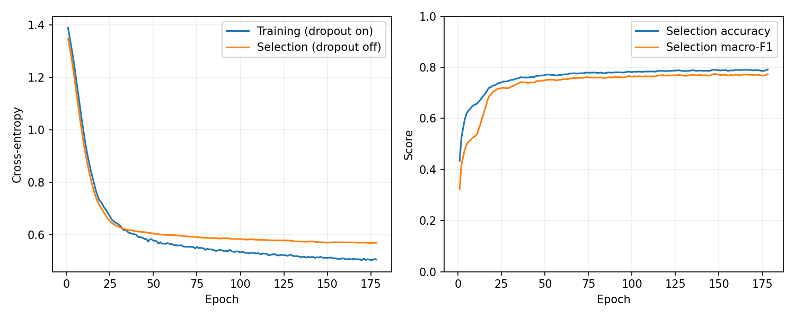
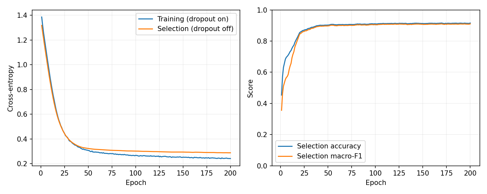

Training curves use dropout-on optimization loss; selection loss uses dropout
off. Neither is identical to restored training CE. GCN improves accuracy by
**12.51 percentage points** and macro-F1 by **0.136286**. TV shows remain weakest
(recall 62.16% -> 84.68%). Reciprocal government/politician confusions fall from
154 MLP errors to 46 GCN errors. Confusion rows are true classes and columns are
predictions; cells show counts and row percentages with the same 0–1 colour scale.

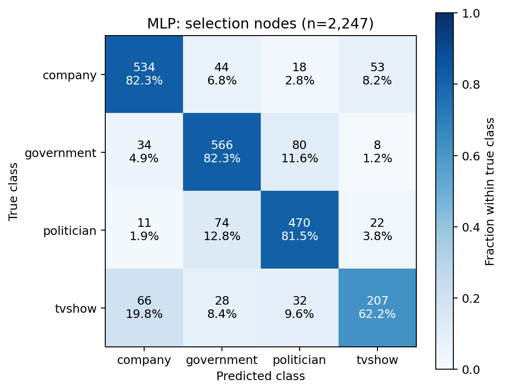
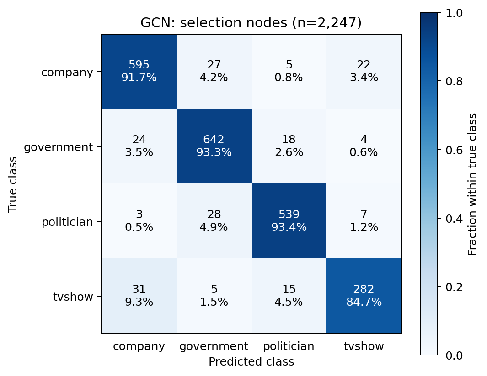

The t-SNE [3] uses all 2,247 selection-node, 64-dimensional `ReLU(conv1)`
embeddings with dropout off and full-graph context. Fixed settings: seed 42,
perplexity 30, PCA initialization, automatic learning rate, Barnes–Hut,
maximum 1,000 iterations and `n_jobs=1`. Labels colour the plot, not the fit.
Broad groupings and a mixed central region are visible. Apparent distances or
cluster sizes are not original-space distances or independent accuracy evidence;
no alternative projections were selected visually.

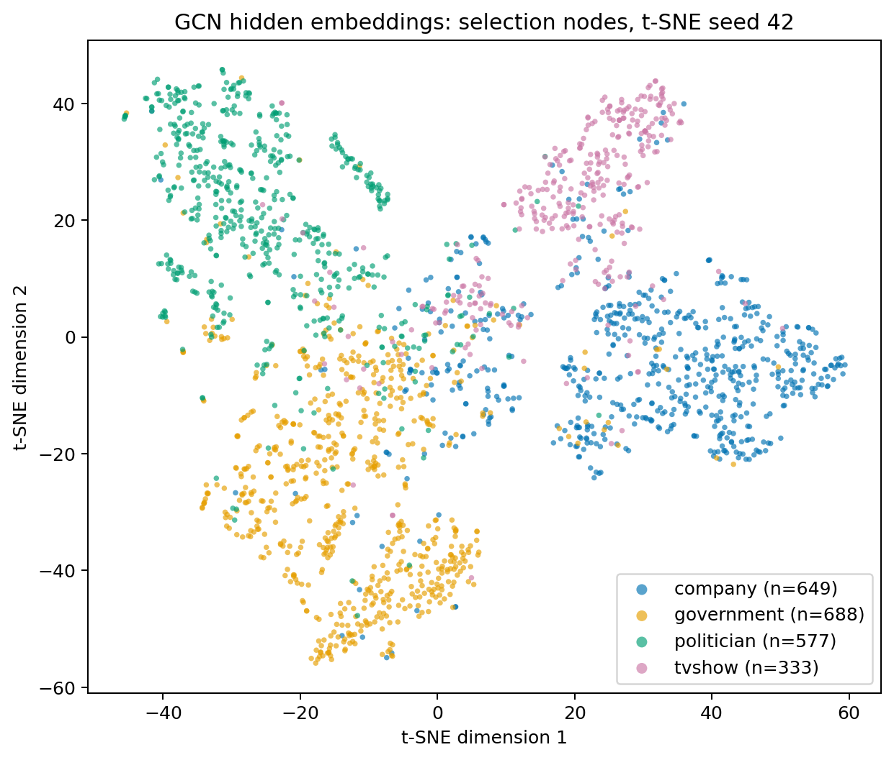

### Computational cost

Measurements use an RTX 2060 SUPER 8 GB, Windows x64 and Python 3.13.14.
Synchronized training timers include steps, selection checks and checkpoint
writes, excluding loading, setup, restored evaluation and plots. These are not
total command runtimes. Training peaks cover setup through restored evaluation.

| Measurement | MLP | GCN |
| --- | ---: | ---: |
| Parameters | 8,516 | 8,516 |
| Training-loop seconds | 1.7253 | 22.7897 |
| Peak training CUDA allocated, MiB | 82.81 | 1,893.84 |
| Peak training CUDA reserved, MiB | 88.00 | 2,240.00 |
| First inference forward, ms | 67.775 | 385.775 |
| Warm inference median, ms | 0.348 | 52.835 |
| Warm inference 95th percentile, ms | 0.627 | 60.560 |
| Peak inference CUDA allocated, MiB | 54.00 | 1,860.69 |
| Peak inference CUDA reserved, MiB | 66.00 | 2,240.00 |

Inference runs `eval()` and `inference_mode()` for **all 22,470 nodes** in both
models, with inputs already resident. The first call includes first-use kernels
and GCN cache creation. Then 20 warm-up calls precede 100 calls, synchronized
before/after each forward. Wall time includes Python/launch overhead, excluding
transfers, softmax, metrics and plotting. GCN warm calls retain its fixed-graph
cache. Inference peaks cover setup through selection metrics before embeddings;
they measure the allocator, not total board usage. Each model starts after
garbage collection/cache clearing.

Repeat medians were 0.322 ms and 58.735 ms: clocks/system load affect timings.
CPU tests overlapped part of the first GCN training run. These are indicative,
not general hardware benchmarks or independent single-page service latencies.
Graph aggregation costs far more than parameter count suggests, but fits on
the available GPU.

## Confidence calibration and selective prediction

Confidence is maximum softmax probability. Temperature scaling [2] fits
`softmax(logits/T)` by minimizing calibration-only NLL for T in [0.05,20].
The code solves the monotone derivative of convex NLL in inverse T by 60
bisection steps, with boundary optima and a T=1 numerical fallback. Positive T
preserves predicted classes, but may change between-node confidence rankings
in multiclass prediction. Neural weights remain unchanged.

Top-label ECE uses **15 equal-width bins**, left-closed/right-open except the
last includes 1. Empty bins have zero weight. ECE sums bin-frequency weights
times absolute accuracy/confidence gaps. NLL uses stable log-softmax. Brier is
the mean **sum over four classes** of squared probability errors (range 0–2).
Calibration and threshold calculations use CPU float64 on frozen model logits.

| Model | Fitted T | Calibration NLL before -> after | Selection ECE before -> after | Selection NLL before -> after | Selection Brier before -> after |
| --- | ---: | ---: | ---: | ---: | ---: |
| MLP | 0.944065 | 0.543933 -> 0.543309 | 0.041857 -> 0.039367 | 0.571925 -> 0.572871 | 0.304633 -> 0.303915 |
| GCN | 0.783617 | 0.233817 -> 0.224742 | 0.039970 -> 0.028464 | 0.290938 -> 0.295654 | 0.139148 -> 0.135150 |

Both temperatures sharpen probabilities. Selection ECE/Brier improve, but
**selection NLL worsens for both**. MLP policy ECE also worsens (0.043922 ->
0.046344). A fitting-objective gain does not ensure uniform out-of-fit
reliability. GCN makes fewer errors but its mistakes have higher mean confidence:
raw 0.6763 versus MLP's 0.5787, scaled 0.7219 versus 0.5900. ECE is bin-dependent
and may conceal rare confident errors; low-count bins are noisy.

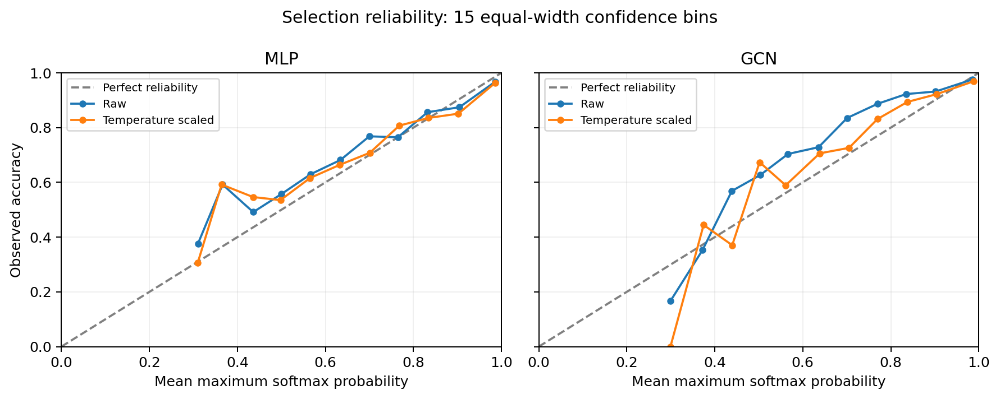


Histograms normalize correct/incorrect groups separately to density and show
their counts; area does not imply equal error prevalence.

The **fixed objective** is highest policy-set coverage with observed accepted
error <=5% and at least **100 accepted nodes** (~8.9% of policy nodes). Accept
iff calibrated confidence >= threshold. Search all unique policy confidences,
including whole ties; if none is feasible, refer all and report error undefined.
This empirical rule is inspired by selective classification [5], without its
formal risk guarantees.

| Model | Frozen threshold | Policy accepted/error | Policy coverage/referral | Fixed-policy selection error | Selection coverage/referral |
| --- | ---: | ---: | ---: | ---: | ---: |
| MLP | 0.8765371476783451 | 26 errors / 525 accepted (4.952%) | 46.71% / 53.29% | 53/1039 (5.10%) | 46.24% / 53.76% |
| GCN | 0.6341986811730764 | 51 errors / 1021 accepted (4.995%) | 90.84% / 9.16% | 117/2081 (5.62%) | 92.61% / 7.39% |

The unchanged rule exceeds 5% error on selection for both models. Threshold
search is adaptive, samples are finite and nodes share graph context. No future
safety or distribution-shift guarantee is established. GCN reduces reviewer
load, while MLP's more conservative selection policy refers 88.72% of its errors
versus GCN's 38.10%. Human accuracy/cost were not measured: referral alone does
not correct a label. Methods and thresholds were not retuned using these outcomes.

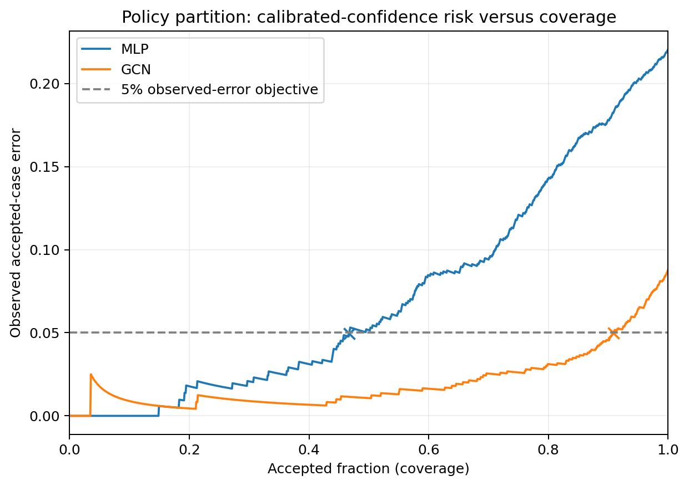

## Development failure evidence

The pre-test five-case investigation used selection nodes 8505, 5712, 9141,
9229 and 1626. It found graph-context benefits and confident failures, motivating
the unchanged cautionary operating policy. For example, 9141 was correct under
MLP but confidently wrong under GCN; 9229 showed the opposite. These observations
did not trigger model or threshold changes. The [development neighborhood
figure](figures/failure_neighbors_selection.png) and `confidence.py` preserve
that analysis; the five primary held-out autopsies follow below.

## Final held-out evaluation

The [frozen protocol](EVALUATION_PROTOCOL.md) was recorded before test-label
release: manifest UTC **2026-10-18 12:59:32**, first release **13:00:04**.
It binds exact checkpoints, policy, data/split identities, model/training
configurations and executable source hashes. The new driver first passed its
guard and pipeline tests on selection labels only. Neither training nor
temperature fitting nor threshold search occurs during final evaluation.
The original 4,494 test nodes were scored identically for both models; the
manifest was rechecked after scoring. The results below retain the first run.

### Classification and comparison with selection

| Model | Selection accuracy | Test accuracy | Test macro precision | Test macro recall | Test macro-F1 | Raw OvR AUROC | Scaled OvR AUROC |
| --- | ---: | ---: | ---: | ---: | ---: | ---: | ---: |
| MLP | 79.08% | 78.95% | 0.785106 | 0.765641 | 0.772748 | 0.946475 | 0.946499 |
| GCN | 91.59% | 92.48% | 0.922368 | 0.917927 | 0.920009 | 0.987667 | 0.987662 |

| Model | Class | Support | Precision | Recall | F1 | Raw OvR AUROC | Scaled OvR AUROC |
| --- | --- | ---: | ---: | ---: | ---: | ---: | ---: |
| MLP | company | 1299 | 0.837880 | 0.827560 | 0.832688 | 0.954963 | 0.954965 |
| MLP | government | 1376 | 0.768325 | 0.853198 | 0.808540 | 0.950976 | 0.950935 |
| MLP | politician | 1154 | 0.780000 | 0.777296 | 0.778646 | 0.949206 | 0.949309 |
| MLP | tvshow | 665 | 0.754221 | 0.604511 | 0.671119 | 0.930753 | 0.930786 |
| GCN | company | 1299 | 0.929128 | 0.918399 | 0.923732 | 0.986175 | 0.986222 |
| GCN | government | 1376 | 0.920366 | 0.949128 | 0.934526 | 0.988610 | 0.988668 |
| GCN | politician | 1154 | 0.938261 | 0.935009 | 0.936632 | 0.990038 | 0.990028 |
| GCN | tvshow | 665 | 0.901716 | 0.869173 | 0.885145 | 0.985847 | 0.985731 |

Temperature scaling leaves predictions, accuracy, precision/recall/F1 and
confusion counts unchanged; multiclass score rankings and hence AUROC can vary.
MLP test accuracy is 0.13 percentage points below selection; GCN is 0.89 points
above it. GCN's test improvement over MLP is **13.53 percentage points**, with
macro-F1 improving from 0.772748 to 0.920009. Single fixed splits do not establish
statistical significance. TV shows remain weakest (recall 60.45% MLP, 86.92%
GCN); government/politician reciprocal test confusions fall from 322 to 91.


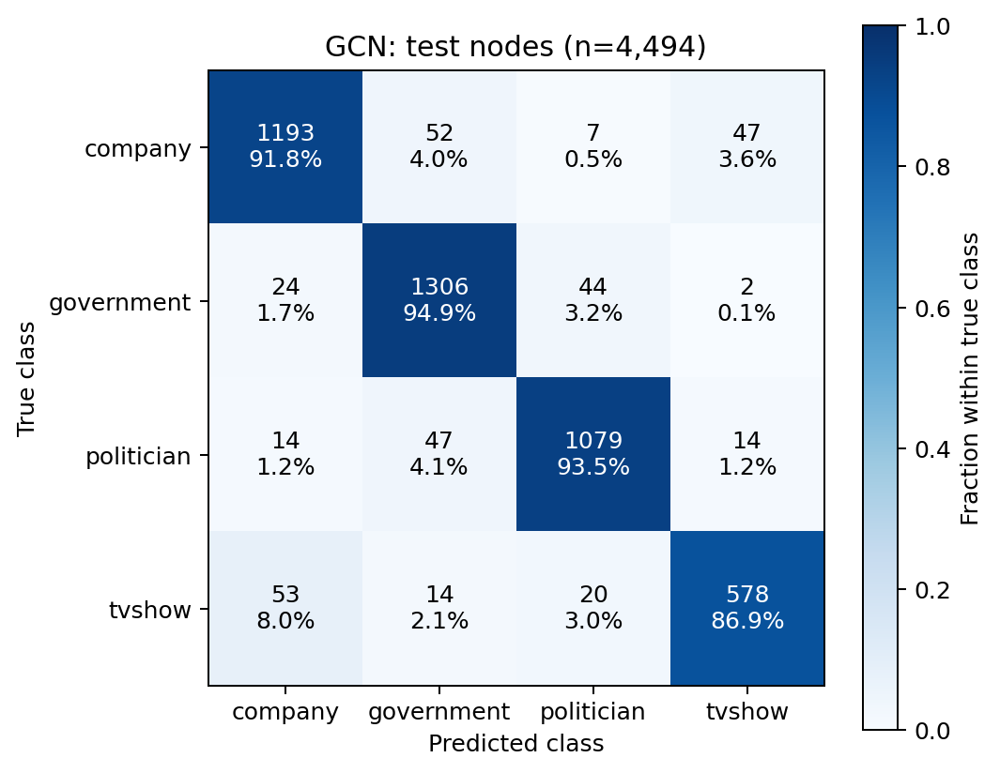

### Final calibration and referral

| Model | Raw ECE | Scaled ECE | Raw NLL | Scaled NLL | Raw Brier | Scaled Brier |
| --- | ---: | ---: | ---: | ---: | ---: | ---: |
| MLP | 0.028585 | 0.022660 | 0.551295 | 0.551707 | 0.290952 | 0.290150 |
| GCN | 0.032919 | 0.017268 | 0.251976 | 0.248782 | 0.123676 | 0.119723 |

GCN has slightly **worse raw ECE** than MLP despite much better classification,
NLL and Brier. With the already fitted temperatures, GCN has lower ECE and
improves all three test reliability metrics. MLP's test NLL worsens slightly,
although ECE/Brier improve. This differs from selection, where NLL worsened for
both; no method was changed after seeing either result. Calibration reliability
is metric- and partition-dependent rather than a uniform architectural gain.

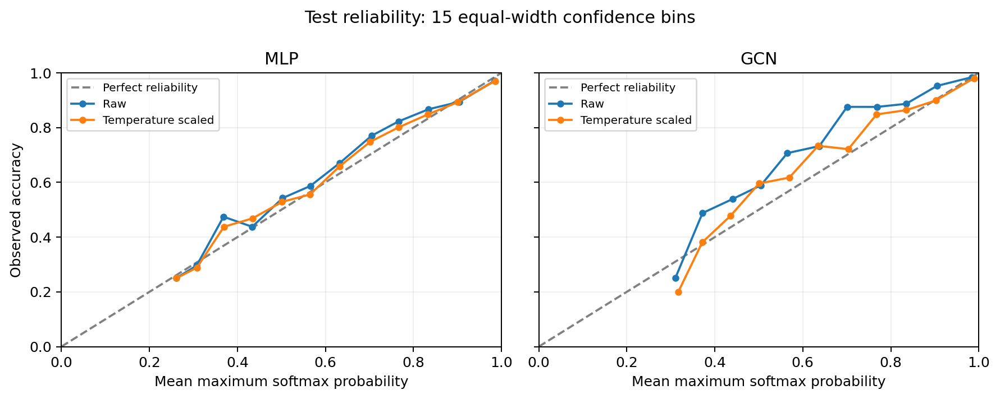
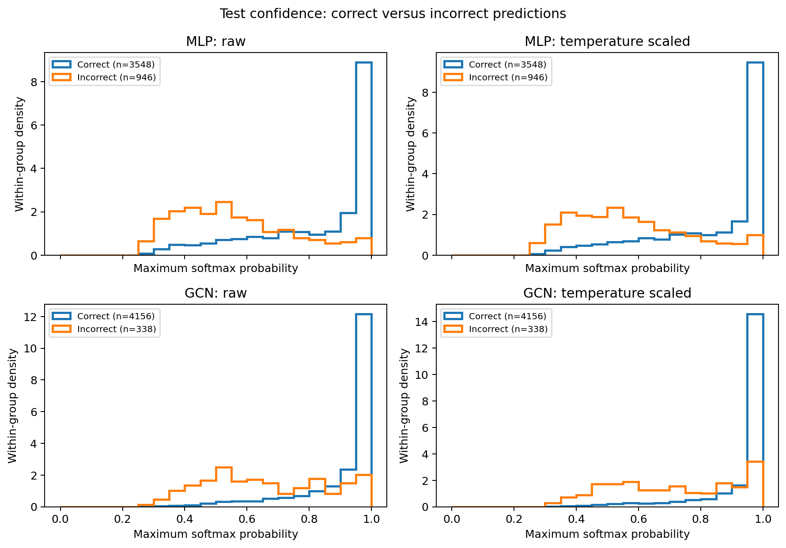

| Model | Unchanged threshold | Accepted / 4494 | Accepted errors | Coverage | Referral rate | Accepted-case error |
| --- | ---: | ---: | ---: | ---: | ---: | ---: |
| MLP | 0.876537148 | 2151 | 90 | 47.86% | 52.14% | 4.184% |
| GCN | 0.634198681 | 4165 | 200 | 92.68% | 7.32% | 4.802% |

Thresholds in this test table are rounded for display; exact values remain in
the frozen protocol and policy artifact. Both meet the observed <=5% test target
**without threshold adjustment**.
MLP refers 2,343 nodes and catches 856/946 errors (90.49%); GCN refers 329 nodes
and catches 138/338 errors (40.83%). These are different coverage operating
points, not a matched-coverage detector comparison. GCN still accepts **200
wrong labels**. Meeting this one test target does not erase the selection-set
failure or prove safety on future/distribution-shifted pages. Diagnostic test
risk curves describe outcomes; no alternative threshold was selected from them.

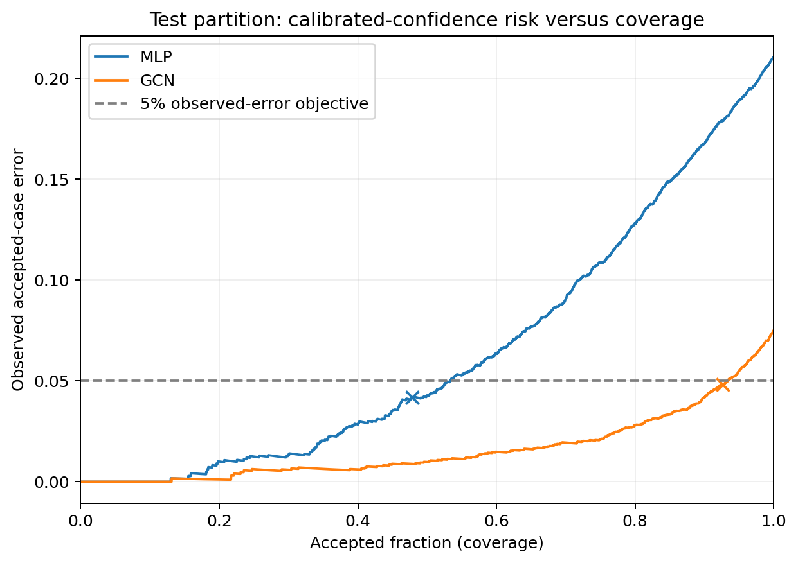

### Five genuine held-out failure autopsies

The same ordered five-case selection rule used in development was frozen before
test inspection. It intentionally illustrates extremes and disagreements, not
their prevalence. Confidence is temperature-scaled; only training-labelled
neighbors inform class composition, with all other neighbor labels unused.

| Node | True class | Degree | MLP prediction / confidence / referred | GCN prediction / confidence / referred |
| --- | --- | ---: | --- | --- |
| 20083 | company | 69 | company / 0.828106 / yes | tvshow / 0.999934 / no |
| 9781 | politician | 1 | politician / 0.381831 / yes | company / 0.300690 / yes |
| 3887 | company | 9 | company / 0.768463 / yes | tvshow / 0.999554 / no |
| 2460 | government | 16 | company / 0.999462 / no | government / 0.985785 / no |
| 22056 | politician | 45 | government / 0.704706 / yes | government / 0.999580 / no |

- **20083:** 32 TV-show versus seven company training-labelled neighbors among
  degree 69. MLP is correct but referred; GCN confidently calls it TV show and
  accepts it. Neighborhood mismatch is consistent with a harmful context effect.
- **9781:** degree one, whose one training-labelled neighbor is politician.
  MLP correctly predicts politician uncertainly; GCN wrongly predicts company
  uncertainly. Both are referred. Sparse context may limit inference, but a
  simple neighbor-label majority does not explain this wrong GCN prediction.
- **3887:** all seven training-labelled neighbors are TV shows (degree nine),
  but the node is company. MLP is correct and referred; GCN's TV-show error is
  highly confident and accepted, again consistent with contextual mismatch.
- **2460:** all seven training-labelled neighbors are government (degree 16).
  GCN corrects MLP's almost-certain company error; both are accepted. This is
  consistent with useful graph context overcoming misleading individual features.
- **22056:** 18 government versus eight politician training-labelled neighbors
  (degree 45). Both predict government incorrectly; only MLP is referred. GCN's
  sharpened error escapes the policy despite its otherwise strong performance.

These are evidence-based associations and explicit hypotheses, not causal
attributions. No graph ablation or page-content review was performed. The
labels are diagnostics only; GCN aggregates features, not neighbor labels.

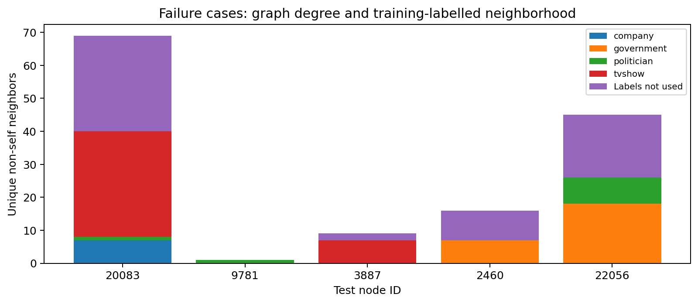

### Final inference resources and reproducibility

| Model | Parameters | Warm median ms | Warm p95 ms | Peak allocated MiB | Peak reserved MiB |
| --- | ---: | ---: | ---: | ---: | ---: |
| MLP | 8516 | 0.395 | 1.004 | 53.98 | 66.00 |
| GCN | 8516 | 56.467 | 64.677 | 1860.67 | 2240.00 |

The frozen 20-warm-up/100-synchronized-call procedure again processes all
22,470 nodes, excluding transfers and metrics from timing. These final memory
peaks cover model/input setup through the final full forward; metrics are on
CPU, unlike development profiling's slightly broader peak scope. Timings vary;
the first measured run is retained rather than selecting a faster repeat.

A clean committed-source snapshot with the explicit Stage 8 source overlay and
copied frozen data/checkpoints/policy reproduced all test logits, classification,
calibration and referral metrics, five case selections and PNG bytes exactly.
It reused the pinned ML environment: this is a clean-source/artifact verification,
not a claim of full retraining or installation in a new ML environment. The
original checkpoints and policy were unchanged throughout.

## Engineering recommendation

Advance GCN to a **supervised analyst-assistance pilot**, not unrestricted
autonomous classification. Its held-out +13.53-point accuracy and 92.68% coverage
at 4.80% observed accepted error justify the measured GPU cost for offline use
on this fixed graph: about 56 ms per full forward and <2 GiB allocated memory
fit the available 8 GB GPU. Keep MLP as the inexpensive feature-only fallback.

Do not promise <=5% production error: selection exceeded that target, the final
test still contains 200 accepted GCN errors, and extreme confidence can be wrong.
Calibration improves some measures but is not uniformly better across partitions.
Reviewer workload/accuracy, new graphs, distribution shift and class-specific
costs need separate validation. Single seed/split and deliberately selected
cases limit generalization; no test-driven retuning was performed.

## Reproduction and inference

Run commands from the repository root in PowerShell. The checked platform is
Windows x64, Python **3.13.14**, torch **2.8.0+cu126**, PyG **2.6.1**, NumPy
**2.2.6**, sklearn **1.7.2**, Matplotlib **3.10.7**, psutil **7.2.2**. Exact
transitive pins are in [requirements-lock.txt](requirements-lock.txt). Install
the CUDA torch index first; this environment also passed CPU tests. Other
platforms/wheels are not claimed bitwise equivalent.

```powershell
python -m venv .venv
.\.venv\Scripts\python.exe -m pip install -r recognition/Facebook_GCN_Jonte/requirements-torch.txt
.\.venv\Scripts\python.exe -m pip install -r recognition/Facebook_GCN_Jonte/requirements-lock.txt
.\.venv\Scripts\python.exe -m pip check
.\.venv\Scripts\python.exe recognition/Facebook_GCN_Jonte/verify_environment.py --require-cuda
```

For a **fresh reproduction without existing outputs**, audit, train both models,
evaluate selection, fit the development policy, then infer:

```powershell
.\.venv\Scripts\python.exe recognition/Facebook_GCN_Jonte/dataset.py
.\.venv\Scripts\python.exe recognition/Facebook_GCN_Jonte/train.py --model mlp
.\.venv\Scripts\python.exe recognition/Facebook_GCN_Jonte/train.py --model gcn
.\.venv\Scripts\python.exe recognition/Facebook_GCN_Jonte/evaluate.py
.\.venv\Scripts\python.exe recognition/Facebook_GCN_Jonte/confidence.py
.\.venv\Scripts\python.exe recognition/Facebook_GCN_Jonte/predict.py --model gcn --node-ids 8505 5712 9141 9229 1626
.\.venv\Scripts\python.exe -m unittest discover -s recognition/Facebook_GCN_Jonte -p "test_*.py" -v
```

Use `--device cpu` for the tested CPU path. Nonempty output directories are
protected from overwrite. Repeats need fresh `--output-dir` and corresponding
explicit `--mlp-checkpoint`/`--gcn-checkpoint`, or predictor `--checkpoint` and
`--policy`. Preserve the approved local artifacts before Stage 8; do not refit
them. A fresh reproduction generates its own matching checkpoint/policy pair;
metadata/file hashes can differ even when weights/results reproduce.

Checkpoints record configuration, data/split hashes and actual executable-code
hashes; historical Git metadata can identify an uncommitted run's parent. Fixed
seeds, deterministic operations, one CPU thread, TF32 off and deterministic
cuBLAS workspace are enabled. Local repeats reproduced histories, selected
weights and PNGs exactly; timings vary and cross-platform bitwise equality is
not promised. Data/weights are never distributed through Git.

### Inference example and errors

Input is the real float32 `[22470,128]` feature matrix and int64 `[2,342004]`
edge index. Node IDs select outputs after the full forward, preserving graph
context. `predict.py` requests **no target labels**. It verifies model/data/split
identity and pairs calibration/referral settings to the exact checkpoint SHA.
It reuses Stage 6's CPU-float64 probability/acceptance functions. Actual output:

```text
node 8505: politician, confidence=0.999967, accept
node 5712: government, confidence=0.284373, refer
node 9141: government, confidence=0.997739, accept
```

The first and third are known development errors, illustrating referral limits.
Outputs are `predictions.csv`, `prediction_summary.json`, `predictions.png` and
`.svg` under ignored `outputs/predict_gcn_selection/`. Rows contain node ID,
predicted class, raw/calibrated confidence, four calibrated class probabilities
and accept/refer decision. Plots show up to 20 requested nodes. Missing weights
or policy produce clear errors before loading data; artifact mismatches,
invalid IDs and nonempty outputs are rejected.

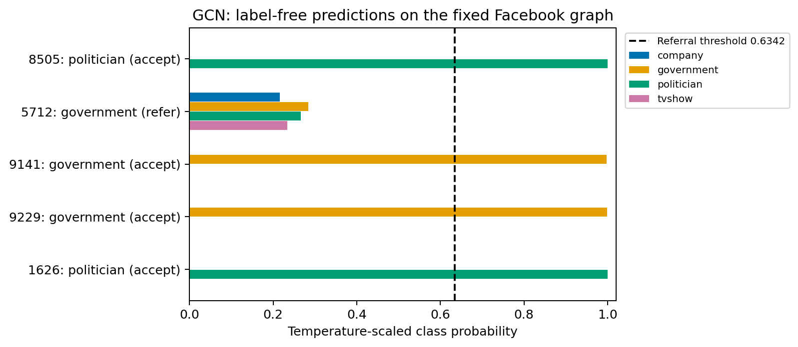

Selection remains the default demonstration partition. Explicit `--partition test`
supports label-free inference without metrics. Final scored evaluation uses the
separately guarded `final_evaluate.py`, after manifest verification and explicit
test-target release.

## Code, validation and repository restrictions

| File | Responsibility |
| --- | --- |
| [modules.py](modules.py) | MLP and GCN components |
| [dataset.py](dataset.py) | Pinned loading/audit, stratification and target guard |
| [train.py](train.py) | Training, selection, early stopping/checkpoints |
| [evaluate.py](evaluate.py) | Selection metrics, resource profiling and t-SNE |
| [confidence.py](confidence.py) | Calibration, policy and failure diagnostics |
| [predict.py](predict.py) | Frozen label-free inference and plots |
| [final_evaluate.py](final_evaluate.py) | Pre-release manifest and guarded frozen final evaluation |
| [export_report.py](export_report.py) | Local Markdown-to-PDF export with one-page feasibility review |
| `test_*.py` | Analytic, real-data and fresh-process verification |

All **62 tests passed together** in Stage 8, including five inference tests and
three new final-evaluation guard/pipeline tests that use selection labels only.
Checks cover normalization, label-role isolation, independent metrics,
known temperature optimum, exhaustive real threshold search, reloads, exact
reproductions, prediction exports and missing files. Fresh processes ran both
models from another working directory. Synthetic fixtures verify formulas only;
reported experiments/figures use real data and trained models. A PyG/Python 3.13
typing deprecation warning persists; execution succeeds. The isolated environment
passed `pip check`.

The independent UCI cross-source test requires the optional local
`data/reference/uci-facebook.zip` (download/hash in `DATA_PROVENANCE.md`). It
passed here; on a fresh checkout without that archive, that one test is skipped.

Section 4.1 restricts Git to code/scripts, documentation and README visuals.
Data, checkpoints, caches and generated CSV/JSON stay ignored. Aggregate
tables/policies remain reproducible under local `outputs/` (and `reports/`
copies), with findings documented above. Previously tracked Stage 5 reports
were untracked in Stage 6 without rewriting history. Never force-add artifacts.
Progressive milestones are recorded in Git; no push or PR has been authorized.

## Final verification and submission status

The assessment audit is in [SUBMISSION_CHECKLIST.md](SUBMISSION_CHECKLIST.md).
The frozen protocol and exact checkpoint identities are in
[EVALUATION_PROTOCOL.md](EVALUATION_PROTOCOL.md). Generated metrics, release
audits, manifests, HTML/PDF and inspection renders remain local under `outputs/`.

For a fresh independent reproduction, first recreate both models and the
development policy as above, then freeze once and release explicitly:

```powershell
.\.venv\Scripts\python.exe recognition/Facebook_GCN_Jonte/final_evaluate.py --freeze-only
.\.venv\Scripts\python.exe recognition/Facebook_GCN_Jonte/final_evaluate.py --release-test-labels
```

Do not regenerate/refit the already approved artifacts for the original final
evaluation. Manifest mismatch or absent release permission prevents label access;
the manifest is verified again afterward. Repeats must preserve all decisions.

The optional PDF tooling is isolated from the frozen ML environment:

```powershell
.\.venv\Scripts\python.exe -m venv recognition/Facebook_GCN_Jonte/outputs/report_env
.\recognition\Facebook_GCN_Jonte\outputs\report_env\Scripts\python.exe -m pip install -r recognition/Facebook_GCN_Jonte/requirements-report.txt
.\recognition\Facebook_GCN_Jonte\outputs\report_env\Scripts\python.exe recognition/Facebook_GCN_Jonte/export_report.py
```

The default output is `outputs/submission/COMP3710_Facebook_GCN_Report.pdf`.
Export uses a headless local Chrome/Edge browser; nothing is uploaded. Its HTML
and inspection files are excluded from Git. The feasibility section has forced
page boundaries. The inspected export has 21 pages and all 15 embedded figures;
the feasibility review occupies page 2 alone. Rendered-page review and automated
checks found no blank pages, missing required content or out-of-bounds text.
`inspect_report.py` reproduces the inspection and extracts the one-page review.
Final inspection details are recorded in the checklist.

**Pending external requirements:** tutor feasibility check-off (reported window
19–30 October), student review of the code/report/disclosure, authorization to
push, PR to upstream `topic-recognition`, and README PDF
submission to Turnitin. Stage 8 commit approval was received on 28 October.
The original internal target was 20 October; confirm the official course deadline. Later teaching-team review responses remain a separate phase.
No push, PR or Turnitin submission has been performed.

**History audit:** seven progressive commits exist through Stage 7. No dataset
or model weights were found in those commits. Three small generated aggregate
CSV/JSON files occur in historical commit `514067a`, removed from the current
tree by `ecfce37`. They conflict with a literal code/scripts-plus-visuals reading
of Section 4.1. This remains an explicit user/staff decision; no history was
rewritten. `.vscode/settings.json` is interpreter configuration, not experiment data.

## Artificial Intelligence Usage Disclosure

OpenAI Codex assisted with planning, substantial code generation/refinement,
debugging, report drafting and execution of data checks, tests, training,
evaluation and plots. Verification included source/checksum audits, label-role
isolation tests, independent metric fixtures, checkpoint reloads, frozen-artifact
checks, repeat experiments, final held-out evaluation and fresh-process inference. Reported automated
checks were executed through Codex. The student reviewed and approved milestones
and remains responsible for personally understanding, independently verifying
and defending the code, decisions and claims; independent student execution is
not claimed here. No experimental results were invented. Source methods and
supplied artifacts are cited.

## References

1. Kipf & Welling (2017), [Semi-Supervised Classification with Graph Convolutional Networks](https://arxiv.org/abs/1609.02907). [PyG 2.6.1 GCNConv](https://pytorch-geometric.readthedocs.io/en/2.6.1/_modules/torch_geometric/nn/conv/gcn_conv.html).
2. Guo et al. (2017), [On Calibration of Modern Neural Networks](https://proceedings.mlr.press/v70/guo17a.html).
3. van der Maaten & Hinton (2008), [Visualizing Data using t-SNE](https://www.jmlr.org/papers/v9/vandermaaten08a.html). [sklearn 1.7 TSNE](https://scikit-learn.org/1.7/modules/generated/sklearn.manifold.TSNE.html).
4. [UCI Facebook Large Page-Page Network, DOI 10.24432/C50900][uci] (2020; CC BY 4.0), and [specification-linked 128-feature reconstruction][artifact]. [Original PyG loader](https://pytorch-geometric.readthedocs.io/en/2.6.1/generated/torch_geometric.datasets.FacebookPagePage.html). Provenance differs as documented above.
5. Geifman & El-Yaniv (2017), [Selective Classification for Deep Neural Networks](https://proceedings.neurips.cc/paper/2017/hash/4a8423d5e91fda00bb7e46540e2b0cf1-Abstract.html). The empirical policy here does not claim that paper's formal guarantees.
6. [sklearn OvR AUROC](https://scikit-learn.org/1.7/modules/generated/sklearn.metrics.roc_auc_score.html) and [PyTorch CUDA timing](https://docs.pytorch.org/docs/stable/notes/cuda.html).
7. Supplied `COMP3710_Report_2026_draft_v2.3.pdf`, Sections 2.1, 3–6 and Appendix A item 6. Its cover says Version 2.2/DRAFT; verify the operative course version. Check-off dates above are student-reported from the updated profile, not inferred from this draft.

[uci]: https://archive.ics.uci.edu/dataset/527/facebook+large+page+page+network
[artifact]: https://github.com/gayanku/facebook_page-page_dataset/tree/ec01d02c39da4385052023ed28e36f0794f61dc8
